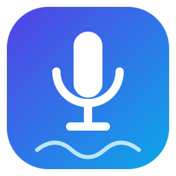
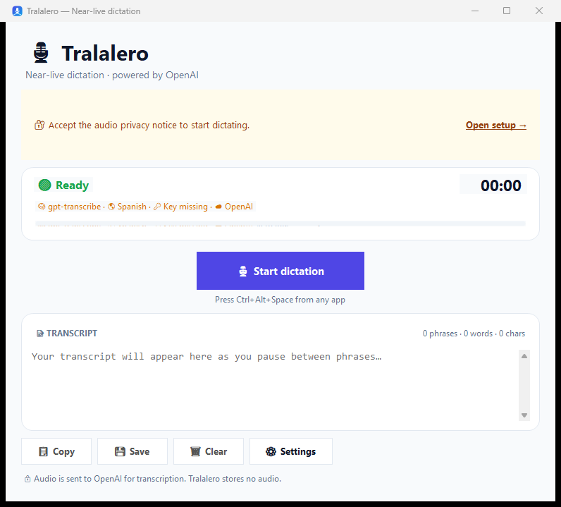

<div align="center">



# 🎙️ Tralalero

**Near-live dictation for Windows, powered by OpenAI.**

Press a hotkey. Speak in phrases. Watch your words appear in the app you were using.

[](https://dotnet.microsoft.com/)
[](https://www.microsoft.com/windows)
[](https://platform.openai.com/docs/guides/speech-to-text)
[](LICENSE)

</div>

---

## ✨ What is Tralalero?

Tralalero is a tiny Windows desktop app for **dictating into any application**. It listens to your microphone, detects natural pauses, sends each phrase to OpenAI for transcription, and shows the text as it arrives.

- 🎤 **Push-to-talk, hands-free phrases** — press `Ctrl+Alt+Space`, speak, pause, and keep going.
- ⚡ **Near-live text** — the transcript appears phrase by phrase after each pause.
- ⌨️ **Paste into the app you were using** — at the end, Tralalero restores focus and sends `Ctrl+V`.
- 🧠 **Current OpenAI model** — uses `gpt-transcribe`, OpenAI's recommended file-transcription model.
- 🔐 **Key stored with Windows DPAPI** — the API key is encrypted for your Windows user.
- 🪟 **Tray-first workflow** — close the window and keep dictating from the notification area.
- 🧪 **Tested core** — VAD, transcript merging, HTTP client, settings, DPAPI, hotkeys, and session orchestration have unit tests.
- 😄 **Emoji-friendly docs** — because software should be readable and a little fun.

> ⚠️ **Tralalero is not offline.** Your microphone audio is sent to OpenAI for transcription. See [Privacy](docs/PRIVACY.md) before using it with sensitive audio.

## 🖼️ Preview



## 🚀 Quick start

### 1. Get an OpenAI API key 🔑

1. Open the [OpenAI API keys page](https://platform.openai.com/api-keys).
2. Create a project key.
3. Make sure the project has billing/usage enabled.

### 2. Run Tralalero 🖥️

Download a release ZIP, extract it, and run `Tralalero.exe`.

For a source build:

```powershell
dotnet build .\Tralalero.slnx -c Release
dotnet run --project .\Tralalero\Tralalero.csproj
```

### 3. Complete setup 👋

On first launch, Tralalero asks you to:

- 🔐 accept the audio privacy notice,
- 🔑 paste and validate your OpenAI API key,
- 🎤 make sure your microphone is available to Windows and selected in Settings.

### 4. Dictate 🎙️

1. Focus the app where you want the text (Notepad, Word, VS Code, a browser…).
2. Press **`Ctrl+Alt+Space`**.
3. Speak naturally and pause between phrases.
4. Press **`Ctrl+Alt+Space`** again to stop.
5. Tralalero finishes the pending phrases, copies the transcript, and pastes it into the app you started from.

> 💡 You can also click the big **🎙️ Start dictation** button. In that case Tralalero keeps the text in its own window and copies it to the clipboard; auto-paste is only used when recording starts from another app.

## 🎛️ How near-live works

```text
🎤 Microphone
   ↓
AudioRecorder (16 kHz, mono, PCM)
   ↓
VoiceActivitySegmenter
   ├─ calibrates background noise
   ├─ waits for speech
   ├─ cuts after ~700 ms of silence
   └─ emits phrases between 0.5 s and 20 s
   ↓
Sequential transcription queue
   ↓
OpenAI /v1/audio/transcriptions (gpt-transcribe)
   ↓
TranscriptAggregator → live text → clipboard → auto-paste
```

This is **phrase-by-phrase near-live**, not word-by-word streaming. It keeps the implementation simple and reliable, avoids cutting words in half, and produces clean final phrases.

📖 Read the full [architecture guide](docs/ARCHITECTURE.md).

## 🧠 Model & cost

| Item | Value |
|---|---|
| Default model | `gpt-transcribe` |
| Endpoint | `POST https://api.openai.com/v1/audio/transcriptions` |
| Audio format | 16 kHz mono 16-bit WAV, one phrase per request |
| Max file size | 25 MB per request (Tralalero phrases are far below this) |
| Billing | Pay-per-use through your OpenAI project |

`gpt-4o-transcribe`, `gpt-4o-mini-transcribe`, and `whisper-1` are **deprecated** and scheduled to shut down on **February 26, 2027**. Tralalero already uses the current `gpt-transcribe` model. See [OpenAI setup](docs/OPENAI.md) for details.

💡 **Cost tip:** silence is not sent to OpenAI. Tralalero only sends detected phrases, and the app shows the number of phrases and recording duration in the status area.

## 🔒 Privacy at a glance

| Data | What happens |
|---|---|
| 🎙️ Microphone audio | Sent to OpenAI for transcription; not stored on disk by Tralalero. |
| 📝 Transcript | Kept in memory, then copied/saved only if you ask. |
| 🔑 API key | Encrypted with Windows DPAPI for your user; never written to logs or settings JSON. |
| 📋 Clipboard | Receives the final transcript so it can be pasted. |
| 📊 Telemetry | None. Tralalero has no analytics, accounts, or tracking. |
| 🌐 Network | Only requests to the OpenAI API. |

Read the full [privacy guide](docs/PRIVACY.md) and [security policy](SECURITY.md).

## 🛠️ Build from source

### Requirements

- Windows 10 or 11 (x64)
- [.NET 10 SDK](https://dotnet.microsoft.com/download)
- An OpenAI API key for actual transcription

### Commands

```powershell
dotnet restore .\Tralalero.slnx
dotnet build .\Tralalero.slnx -c Release
dotnet test .\Tralalero.slnx -c Release
dotnet run --project .\Tralalero\Tralalero.csproj
```

### Publish a self-contained ZIP

```powershell
pwsh .\scripts\publish.ps1 -Version 0.1.0
```

The ZIP is written to `artifacts\Tralalero-0.1.0-win-x64.zip` and includes the app, README, license, privacy guide, and third-party notices.

## 🧪 Tests

The test suite does **not** call OpenAI. It uses a fake `HttpMessageHandler` and fake audio/transcriber implementations.

```powershell
dotnet test .\Tralalero.slnx -c Release
```

Covered areas:

- 🎚️ VAD segmentation with synthetic PCM
- 🧩 transcript merging and prompt context
- 🌐 multipart request shape, retries, and error mapping
- 🔐 DPAPI key storage
- ⚙️ settings round-trip and corrupt-file recovery
- ⌨️ hotkey parsing and display
- 🎙️ dictation session start/stop/finalization

Manual checks that need a real microphone/key are described in [Development](docs/DEVELOPMENT.md#-manual-test-checklist).

## 📁 Project layout

```text
Tralalero.slnx
├─ Tralalero/                    # 🖥️ WinForms app
│  ├─ Program.cs                 #    entry point, single instance, global errors
│  ├─ App/                       #    forms, tray, overlay, theme, UI text
│  ├─ Core/
│  │  ├─ Audio/                  #    recorder, VAD, WAV writer
│  │  ├─ OpenAI/                 #    API client, models, exceptions
│  │  ├─ Transcription/          #    session, queue, aggregator
│  │  ├─ Security/               #    DPAPI key store
│  │  ├─ Settings/               #    settings model + service
│  │  ├─ Interop/                #    hotkey, paste, startup, single instance
│  │  └─ Infrastructure/         #    paths, logging
│  └─ Assets/                    #    app icon
├─ Tralalero.Tests/              # 🧪 xUnit tests
├─ docs/                         # 📚 architecture, usage, API, privacy…
├─ scripts/                      # 🚀 publish + icon generation
├─ .github/workflows/            # ⚙️ CI and release
└─ README.md
```

## 🗺️ Roadmap

- 🎚️ Improve VAD with an optional neural VAD backend.
- 🖥️ Show a live waveform in the recording overlay.
- 🔁 Add a local Whisper provider behind `ITranscriber` for offline use.
- 🌍 Add UI localization (English first, Spanish next).
- 📦 Add an installer/MSIX and code signing.
- 📝 Add custom vocabulary / keyword hints.
- 🧵 Support word-level streaming through OpenAI Realtime transcription.

## 🤝 Contributing

Contributions are welcome! Start with [CONTRIBUTING.md](CONTRIBUTING.md), run the tests, and keep the emoji policy: plenty of emojis in docs/UI, none in identifiers or paths.

## 📄 License

MIT © 2026 Tralalero contributors. See [LICENSE](LICENSE).

OpenAI, Whisper, Windows, and .NET are trademarks of their respective owners. Tralalero is an independent project and is not affiliated with OpenAI.

## 🙏 Credits

- Built with [.NET](https://dotnet.microsoft.com/) and [WinForms](https://learn.microsoft.com/dotnet/desktop/winforms/).
- Audio capture by [NAudio](https://github.com/naudio/NAudio).
- Transcription by the [OpenAI Audio API](https://platform.openai.com/docs/guides/speech-to-text).
- Tests with [xUnit](https://xunit.net/).
- Icon and logo generated for this project.
