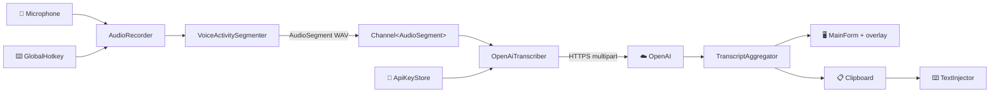
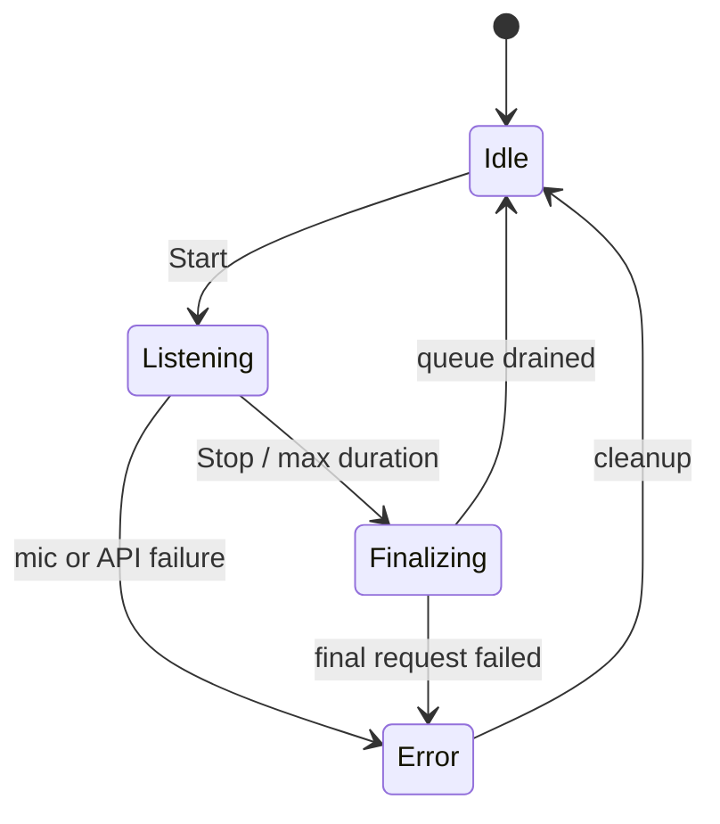

# 🏗️ Architecture

> How Tralalero turns microphone frames into near-live text without becoming a distributed system.

## 🎯 Goals

- 🪶 **Small surface area:** one WinForms app, one test project, no database, no container, no background service.
- ⚡ **Near-live:** show a phrase shortly after the speaker pauses.
- 🧱 **Testable core:** audio segmentation, transcript merging, HTTP behavior, settings, and security are unit-testable without a microphone or API key.
- 🔐 **Local-first UI, configurable transcription endpoint:** audio leaves the machine only for the configured request; the key stays encrypted on disk.
- 🧩 **Provider seam:** `ITranscriber` makes a future local Whisper provider possible without touching the UI.

## 🧭 Runtime flow



## 🧩 Components

| Component | Layer | Responsibility |
|---|---|---|
| `Program` | App | Single-instance mutex, global exception handling, dependency wiring. |
| `MainForm` | App | Main window, state machine, timer, transcript actions, tray integration. |
| `OnboardingForm` | App | Consent, API key entry/validation, first-run setup. |
| `SettingsForm` | App | Model, language, microphone, VAD sensitivity, hotkey, behavior. |
| `RecordingOverlay` | App | Top-most, non-activating recording/transcribing pill. |
| `TrayController` | App | Tray icon, context menu, notifications. |
| `AudioRecorder` | Core/Audio | NAudio capture at 16 kHz, mono, 16-bit; level events; stop handshake. |
| `VoiceActivitySegmenter` | Core/Audio | Energy-based VAD, pre-roll, hangover, phrase sizing, WAV creation. |
| `WavWriter` | Core/Audio | Adds a PCM WAV header around raw microphone bytes. |
| `OpenAiEndpoint` | Core/OpenAI | URL normalization, host detection, request URL building, public/local validation. |
| `OpenAiClient` | Core/OpenAI | Multipart request, auth, timeout, retry, safe error mapping, OpenAI/custom compatibility. |
| `OpenAiTranscriber` | Core/Transcription | Implements `ITranscriber` using `OpenAiClient`. |
| `DictationSession` | Core/Transcription | One recording lifecycle: queue, sequential requests, state, events. |
| `TranscriptAggregator` | Core/Transcription | Joins phrases, normalizes whitespace, keeps prompt context. |
| `ApiKeyStore` | Core/Security | DPAPI `CurrentUser` encryption and atomic storage. |
| `SettingsService` | Core/Settings | JSON load/save, defaults, normalization, corrupt-file quarantine. |
| `GlobalHotkey` | Core/Interop | `RegisterHotKey` + `WM_HOTKEY` handling on the main form. |
| `TextInjector` | Core/Interop | Clipboard write, focus restoration, `SendInput` `Ctrl+V`. |
| `WindowHelper` | Core/Interop | Foreground capture, title lookup, `AttachThreadInput` fallback. |
| `AppLogger` | Core/Infrastructure | Daily rolling logs with secret redaction; never logs transcripts. |

## 🧠 Voice activity segmentation

The VAD is deliberately simple and transparent:

| Parameter | Value | Why |
|---|---:|---|
| Sample rate | 16 kHz | Whisper-friendly, small payloads. |
| Frame size | 20 ms | Fast response without excessive CPU. |
| Calibration | 500 ms | Estimates the noise floor from the 20th percentile. |
| Pre-roll | 300 ms | Keeps the first syllable. |
| Hangover | 700 ms | Avoids cutting mid-word at a short pause. |
| Tail kept | 200 ms | Gives the API a little trailing context. |
| Minimum phrase | 500 ms | Rejects clicks and short noises. |
| Maximum phrase | 20 s | Keeps each request far below the 25 MB API limit. |
| Sensitivity | Low / Medium / High | Multiplier over the adaptive noise floor. |

If a phrase reaches 20 seconds, Tralalero emits it and immediately starts a new segment. This is rare in dictation; the 20-second split is a safety valve, not the normal path.

### Why phrases instead of fixed chunks?

Fixed 3-second chunks cut words and produce duplicate/incorrect text at boundaries. Silence-based phrases:

- align with natural dictation,
- keep words intact,
- reduce silent audio sent to OpenAI,
- make the live transcript easier to read.

## 🔄 Session state machine



- 🟢 `Idle`: no microphone, no requests.
- 🔴 `Listening`: microphone active; phrases may be in flight.
- ⏳ `Finalizing`: microphone stopped, last phrase flushed, queue draining.
- ⚠️ `Error`: partial transcript preserved; the UI offers a clean restart.

The session raises events (`TranscriptUpdated`, `StateChanged`, `Error`, `Completed`, `LevelChanged`). The UI marshals every event to the WinForms thread with `BeginInvoke`.

## 🧵 Threading model

| Thread | Work |
|---|---|
| UI thread | Forms, tray, clipboard, `SendInput`, state rendering. |
| NAudio callback | Copies PCM into a byte array and raises `AudioAvailable`/`LevelChanged`. |
| Transcription worker | Reads the `Channel<AudioSegment>` and awaits HTTP requests sequentially. |
| Thread pool | `Task.Delay` for retries, `HttpClient` I/O, log writes. |

Requests are **sequential** on purpose:

- preserves phrase order,
- keeps prompt context coherent,
- avoids hammering rate limits,
- makes the transcript deterministic.

## 🌐 Transcription request shape

```http
POST {baseUrl}/audio/transcriptions
Authorization: Bearer <key>   # omitted for keyless custom endpoints
Content-Type: multipart/form-data

file=segment.wav
model=gpt-transcribe
languages[]=es                # OpenAI hosts
# language=es                 # custom hosts
prompt=<last ~240 chars>      # OpenAI hosts only
```

The response is JSON with a `text` field and optional detected `languages`. Tralalero keeps the response parsing tolerant of API-compatible servers that return plain text.

**Compatibility mode** is inferred from the host:

| Host | Auth | Language field | Prompt | `/models` |
|---|---|---|---|---|
| `api.openai.com` | Bearer, required | `languages[]` | Sent | Required |
| Anything else | Bearer if key; none if empty | `language` | Skipped | Best-effort |

The same `OpenAiClient` handles both, so the UI only needs a Base URL and model.

## 🛡️ Failure handling

| Failure | Behavior |
|---|---|
| `401` / `403` | Stop, show “The endpoint rejected the API key”, keep partial transcript. |
| `429` | Retry with `Retry-After` or exponential backoff, up to 3 attempts. |
| `5xx` | Retry with backoff, up to 3 attempts. |
| `400` / `413` | Show the API message; do not retry. |
| Timeout | Retry up to 3 attempts, then show a timeout message. |
| Network unreachable | Retry, then show “Check your internet connection.” |
| Microphone missing | Friendly message with Windows privacy settings guidance. |
| Corrupt settings | Move to `settings.json.corrupt-<timestamp>` and use defaults. |
| Corrupt DPAPI blob | Warn and ask for the key again; never crash. |

Logs contain model, duration, phrase count, HTTP status, and errors. They **never** contain API keys or transcript text.

## 🔐 Security boundaries

- 🔑 API key: DPAPI `CurrentUser`, stored in `%APPDATA%\Tralalero\credentials.bin`.
- 📝 Settings: `%APPDATA%\Tralalero\settings.json`; no secrets.
- 🧾 Logs: `%LOCALAPPDATA%\Tralalero\logs`; redacted and metadata-only.
- 🎙️ Audio: memory-only; no WAV files are written by the app.
- 📋 Clipboard: final transcript only; user-initiated or auto-copy/paste.
- 🌐 Network: the configured transcription endpoint only; no telemetry endpoint.

## 🧭 Design decisions

1. **WinForms over WPF/Electron.** The app is a small tray utility; WinForms ships with .NET and starts instantly.
2. **OpenAI API over local Whisper.** Best transcription quality and no 1–2 GB model download. The `ITranscriber` seam leaves room for a local provider.
3. **Phrase-based near-live over Realtime API.** Much simpler lifecycle, no WebSocket reconnection, clean final phrases; latency is acceptable for dictation.
4. **Single app assembly + test project.** Avoids over-layering while keeping audio, HTTP, and settings testable. Folders communicate boundaries.
5. **Energy VAD over a neural VAD.** Zero extra dependencies, predictable CPU, easy unit tests. Sensitivity is user-adjustable.
6. **One active endpoint over profiles.** Base URL + editable model cover the common OpenAI-compatible cases without a profile manager. Per-profile keys can be added later if needed.
7. **Auto compatibility over advanced UI.** The host decides between OpenAI's `languages[]`/prompt shape and the broader `language`/keyless shape.
8. **No transcript persistence.** Privacy by default; the user explicitly saves a `.txt` when desired.

## 🔮 Future extension points

- `ITranscriber` → local Whisper/Whisper.net provider.
- `DictationSession` → optional streaming/Realtime provider.
- `VoiceActivitySegmenter` → pluggable neural VAD.
- `TextInjector` → optional “type as I speak” mode using `SendInput` Unicode events.
- `SettingsForm` → keyword/custom vocabulary hints (`keywords[]` in the API).

---

📖 Next: [Usage](USAGE.md) · [OpenAI setup](OPENAI.md) · [Development](DEVELOPMENT.md)
