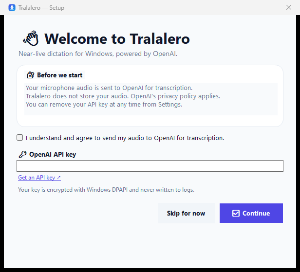

# 🎙️ Usage guide

> From first launch to dictating into any Windows app.

## 📋 Requirements

- 🪟 Windows 10 or Windows 11, x64.
- 🌐 Internet access while dictating (audio goes to OpenAI).
- 🔑 An OpenAI API key with billing/usage enabled.
- 🎤 A microphone that Windows can access.
- 💾 About 100 MB free for the app; the release is self-contained.

## 📦 Install

### From a release ZIP

1. Download `Tralalero-<version>-win-x64.zip`.
2. Extract it to a folder you can write to (for example `C:\Tools\Tralalero`).
3. Run `Tralalero.exe`.
4. Optionally pin it to Start or create a desktop shortcut.

> 🛡️ Windows SmartScreen may warn because the executable is unsigned. Choose **More info → Run anyway** only if you trust the build. Code signing is on the roadmap.

### From source

```powershell
dotnet build .\Tralalero.slnx -c Release
dotnet run --project .\Tralalero\Tralalero.csproj
```

## 👋 First run

1. **🔐 Privacy notice.** Read the audio notice and tick the consent checkbox.
2. **🔑 OpenAI API key.** Paste a project key and press **Continue**. Tralalero validates it against `GET /v1/models` without spending transcription credits.
3. **✅ Ready.** The main window shows `🟢 Ready` and a `🔑 Key ready` badge.

If you choose **Skip for now**, the app opens with a banner. You can return via **Open setup →** or **Settings**.



## 🎤 Dictate

### Into another application (recommended)

1. Click into the target app (Notepad, Word, VS Code, a browser…).
2. Press **`Ctrl+Alt+Space`**.
3. The overlay shows `🔴 Listening` and a timer.
4. Speak in natural phrases. Pause ~0.7 seconds between phrases.
5. Press **`Ctrl+Alt+Space`** again to stop.
6. Tralalero finishes pending phrases, copies the text, restores the target window, and sends `Ctrl+V`.

> 💡 If auto-paste is blocked by Windows or the target app is elevated, Tralalero leaves the transcript in the clipboard and tells you to paste manually.

### Into Tralalero itself

1. Click **🎙️ Start dictation**.
2. Speak and pause naturally.
3. Click **⏹️ Stop dictation**.
4. The transcript stays in the window for editing, copying, or saving.

When recording starts from Tralalero's own button, the app does **not** auto-paste into itself; that would duplicate the text.

## ✍️ Transcript actions

| Action | What it does |
|---|---|
| 📋 Copy | Copies the full transcript to the clipboard. |
| 💾 Save | Saves a UTF-8 `.txt` file with a timestamped default name. |
| 🗑️ Clear | Clears the transcript after a confirmation-free click. |
| ⚙️ Settings | Opens configuration. |

The transcript box is editable when idle. While listening, it is read-only so live updates do not fight your cursor.

## ⚙️ Settings

| Setting | Default | Notes |
|---|---|---|
| 🔑 API key | none | Encrypted with DPAPI; **Test key** validates it. |
| 🧠 Model | `gpt-transcribe` | OpenAI's recommended file-transcription model. |
| 🌎 Language | Spanish | Choose **Auto-detect** if you switch languages. |
| 🎤 Microphone | first device | Device list comes from Windows/NAudio. |
| 🎚️ Voice sensitivity | Medium | Low for noisy rooms, High for quiet rooms. |
| ⌨️ Global hotkey | `Ctrl+Alt+Space` | Click the field and press a new combination. At least one modifier is required. |
| ⏱️ Maximum recording | 10 minutes | Safety limit; the session stops automatically. |
| 📋 Auto-copy | On | Copy the final transcript. |
| ⌨️ Auto-paste | On | Paste into the window that was active when recording started. |
| 🪟 Close to tray | On | The close button hides Tralalero instead of exiting. |
| 🚀 Start with Windows | Off | Adds a per-user `Run` registry value. |

> 🧠 Changing the model or language applies to the **next** phrase/session. The current session keeps its snapshot.

## 🖥️ Tray

Closing the window keeps Tralalero running in the notification area. Double-click the tray icon to restore it.

Tray menu:

- 🎙️ **Start / Stop dictation**
- ⚙️ **Settings**
- 📂 **Open logs**
- ℹ️ **About**
- ❌ **Exit**

Use **Exit** to actually close the app; the window's **X** only hides it when **Close to tray** is enabled.

## ⏱️ Near-live behavior

- Tralalero waits for a **pause** before sending a phrase. It does not stream word by word.
- Each phrase becomes one OpenAI request; the text arrives a moment after you pause.
- A phrase can be at most 20 seconds. If you speak continuously, it may split at 20 seconds.
- A recording can be at most 10 minutes by default.
- The status badge shows `🔴 Listening`, `⏳ Finishing`, and `🟢 Ready`.
- The overlay is intentionally non-activating so it never steals focus from your target app.

### Tips for best results

- 🎙️ Use a headset or a microphone close to your mouth.
- 🤫 Reduce background noise; lower sensitivity in noisy rooms.
- 🗣️ Speak at a natural pace and pause between sentences.
- 🌎 Set the language explicitly if you mostly speak one language.
- 🔌 Keep the connection stable; requests retry automatically but cannot succeed offline.

## 🔐 Privacy & data

- The microphone audio is sent to OpenAI for transcription.
- Tralalero does not write audio to disk.
- Transcripts remain in memory until you copy or save them.
- Logs contain metadata only (model, duration, phrase count, errors), never transcript text.
- The API key is encrypted with Windows DPAPI for your user.

Read [PRIVACY.md](PRIVACY.md) for the full data flow.

## 🧹 Reset / uninstall

| Goal | Action |
|---|---|
| Remove the API key | Settings → **Remove key**. |
| Reset all settings | Close Tralalero, delete `%APPDATA%\Tralalero\settings.json`. |
| Remove logs | Delete `%LOCALAPPDATA%\Tralalero\logs`. |
| Full uninstall | Delete the extracted app folder, `%APPDATA%\Tralalero`, and `%LOCALAPPDATA%\Tralalero`; disable **Start with Windows** first. |

## 🆘 Something is wrong?

Check [TROUBLESHOOTING.md](TROUBLESHOOTING.md). Logs are at `%LOCALAPPDATA%\Tralalero\logs` and can be opened from Settings.

---

📖 Next: [OpenAI setup](OPENAI.md) · [Troubleshooting](TROUBLESHOOTING.md)
